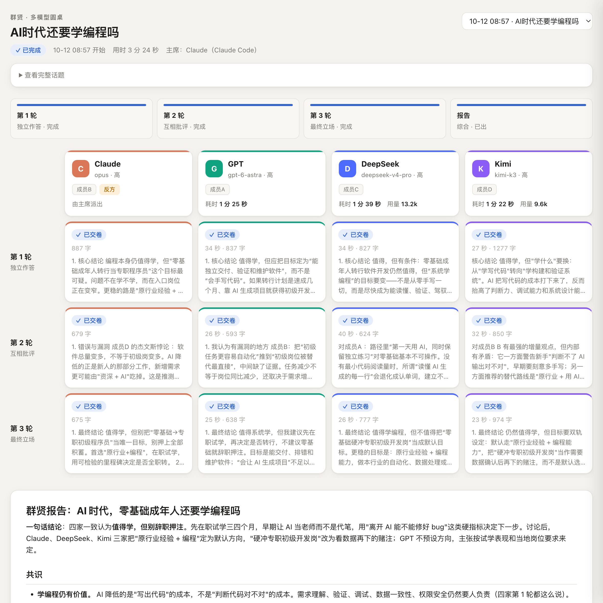

# Qunxian 群贤

> *"All the worthies have gathered."* Put several LLMs around a table on your question: **independent answers → anonymous critique → final positions**, then a chair writes a synthesis report.

[中文](README.md)



## Why several models

- **One model has fixed blind spots.** Ask one model to play several roles and the "disagreement" is often staged. Models from different labs, trained on different data with different preferences, are more likely to genuinely disagree.
- **Models love to agree.** In a free-form chat, whoever speaks first anchors everyone else. So Qunxian has members **answer independently** first, then **critique anonymously** (no one knows which lab wrote what), then state a **final position**. Each meeting also picks a random member as **devil's advocate**.
- **Traceable conclusions.** Every view in the report is attributed, and all raw answers are kept so you can check the chair's work.

## Features

| | |
|---|---|
| **Any members** | Any OpenAI-compatible API (OpenAI, DeepSeek, Kimi, Qwen, GLM, Gemini, local Ollama…), any CLI (Codex, `claude -p`, your own script), or subagents dispatched by the chair agent itself. As many as you like. |
| **Any chair** | Claude Code, Codex, or any agent that can run shell commands. No agent? One terminal command runs the whole meeting. |
| **Unified effort levels** | off / low / medium / high / max, translated into each provider's own parameters. `check --effort-test` measures whether a model actually honors them. |
| **Live board** | Who's answering, who's done, time and tokens per member, full text on click. |
| **Zero dependencies** | Python 3.9+ standard library only. |
| **Private** | Keys come only from environment variables or the macOS Keychain, never from files; the board listens on localhost only. |

## Quick start

```bash
git clone https://github.com/HeartY1ng/qunxian.git
cd qunxian
./qunxian init --lang en      # creates ~/.qunxian/config.json
```

Edit the config (remove members you don't have, set where keys live), then:

```bash
./qunxian check                      # verify every member works
./qunxian run "your question"        # run a whole meeting
./qunxian board --open               # in another terminal: the live board
```

The report lands in `~/.qunxian/records/<date-title>/report.md`.

## Use it from an agent (recommended)

An agent chair gives the best results: it adds context, dispatches its own subagents as members, and writes the report. `skills/qunxian/SKILL.md` follows the common skill format, and **Claude Code and Codex use the same file**. (The skill is written in Chinese; agents follow it fine and reply in your language.)

**Claude Code** — type at the Claude Code prompt:

```
/plugin install qunxian --marketplace HeartY1ng/qunxian
```

**Codex** — link the skill folder into Codex's skills directory:

```bash
ln -s "$PWD/skills/qunxian" ~/.codex/skills/qunxian
```

**Other agents** (Cursor, Gemini CLI…) — add a line to your `AGENTS.md` / `GEMINI.md`:

```
When the user asks for a Qunxian discussion, read <repo path>/skills/qunxian/SKILL.md and follow it.
```

Then just say: "Run a Qunxian roundtable on: …", optionally adding "quick", "only DeepSeek and Kimi", or "max effort".

## Configuring members

`members` is a list; each entry is one member. Three types:

| type | What it is | Required |
|---|---|---|
| `openai` | Any OpenAI-compatible HTTP API | `base_url`, `model`; key via `api_key_env` (env var name) or `keychain` (macOS Keychain item) |
| `cli` | Any command: question on stdin, answer on stdout | `preset` (`codex` or `claude` built in) or your own `command` |
| `host` | A subagent the chair agent dispatches itself (e.g. Claude inside Claude Code) | nothing; agent mode only, skipped by `run` |

Other fields: `keychain_account` (Keychain account name, if you stored the key with `-a`), `cheap_model` (used by the quick preset), `effort` (member default), `enabled: false`, `color`, `extra_body` (sent with every request), `max_tokens`. `chair` names the member that writes the report in terminal mode; it can be any `openai`/`cli` member and need not take part.

### Effort levels

Five levels: `off / low / medium / high / max`. Each `openai` member declares how it is controlled with `effort_style`:

| effort_style | Sends | For |
|---|---|---|
| `effort` | `reasoning_effort` | APIs with effort levels (e.g. OpenAI) |
| `toggle` | `thinking: {type: enabled/disabled}` | APIs that can only switch thinking on/off |
| `effort+toggle` | thinking off at `off`; otherwise on + `reasoning_effort` | APIs that support both |
| `none` (default) | nothing | APIs with no control |

Use `effort_values` to remap level names (e.g. `max` → `xhigh`), or `effort_body` to spell out the exact fields per level.

**Not sure a model honors effort?** Run `./qunxian check <member id> --effort-test`. It runs the same reasoning puzzle at off/low/high and compares reasoning tokens. Our October 2026 results:

| Model | off | low | high | Verdict |
|---|---|---|---|---|
| Kimi (kimi-k3) | 0 | 525 | 871 | levels work → `effort+toggle` |
| DeepSeek (deepseek-v4-pro) | 0 | ~19k | ~22k | on/off only → `toggle`; use `deepseek-flash` for speed |

### Presets

| Preset | Rounds | Effort | Notes |
|---|---|---|---|
| quick | 1 | low | swaps in `cheap_model` where set |
| standard (default) | 3 | high | |
| deep | 3 | max | slowest and most expensive |

Override per meeting: `--preset quick --members a,b --effort medium --rounds 2`.

### Where data lives

Config and records live in a data folder, found in this order: `$QUNXIAN_HOME`; the nearest `.qunxian/` folder walking up from the current directory (`init --here` creates one, handy for per-project setups); `~/.qunxian/`.

## Limitations

- **The chair is biased.** It's a model too and may favor members from its own lab. The report names the chair, and raw answers are kept for checking.
- **Cost grows with members × rounds.** In rounds 2–3 everyone reads everyone. Beyond ~6 members it gets slow and pricey. Heavy thinkers (e.g. DeepSeek) can burn 10k+ tokens per round.
- **Members don't browse.** They answer from their own knowledge; put any up-to-date material in the question.
- **Subscription CLIs** (Codex, `claude -p`) report no token counts; the board shows time only.

## Tests

`python3 -m unittest discover tests` runs a full meeting with fake members: no network, no cost.

## Uninstall

Delete the repo folder and the data folder (`~/.qunxian/` or a project's `.qunxian/`); `/plugin uninstall qunxian` in Claude Code; `rm ~/.codex/skills/qunxian` for Codex. Qunxian changes nothing else on your machine.

## License

[MIT](LICENSE)
